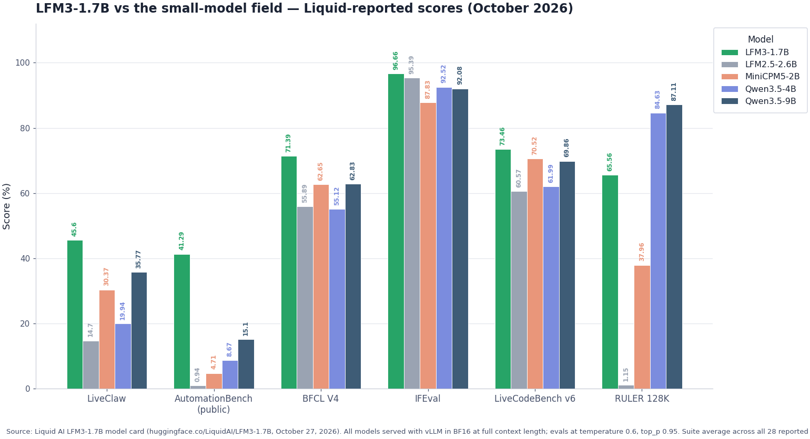
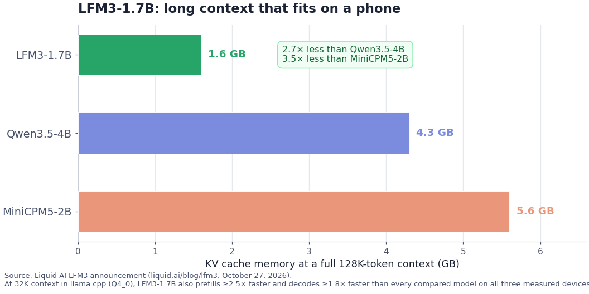

# LFM3: A Technical Deep Dive into Liquid AI's Tri-Hybrid 2B Multimodal Family

> **TL;DR** — Liquid AI released **LFM3** on **October 27, 2026**, a new generation of Liquid Foundation Models built for "specialized intelligence." The first release is six 2B-class open-weight models — text, vision, audio, omni, and two decision models — all branched from a single **LFM3-1.7B-Base** backbone trained on **22T tokens**. The headline change is a **tri-hybrid architecture**: of 24 layers, 13 are gated short convolutions (kernel size 7, up from 3), 5 are sliding-window attention (256-token window), and 6 are global attention, with head-wise gated attention, partial RoPE, and sandwich norm. **LFM3-1.7B** beats its predecessor LFM2.5-2.6B using **35% fewer parameters**, averages **49.37** across its reported suite (vs 47.24 for Qwen3.5-9B), posts the best agent scores in its class (LiveClaw 45.60, AutomationBench 41.29, WebArena-Verified 38.42), carries a **256K-token context window**, fits in **~1 GB at 4-bit**, and decodes **1.8–2.8× faster than the next-fastest model** on every edge device Liquid measured. Post-training runs through four stages ending in agentic RL inside real harnesses (Hermes Agent, Pi, OpenClaw). Weights are open under the **LFM Open License v1.0** on Hugging Face. This post breaks down the architecture, the full benchmark record, each family member, the training pipeline, how to run it locally, and what it means for the edge-model race.

---

## 1. What LFM3 Actually Is

LFM3 is Liquid AI's third-generation Liquid Foundation Model family, announced October 27, 2026. The framing Liquid uses is "specialized intelligence": instead of one large general-purpose model in the cloud, LFM3 targets small models that can be fine-tuned on your own data and deployed where your application actually runs — a phone, a laptop, a Raspberry Pi, a car, or a single GPU box. The first LFM3 release covers the **2B parameter range**, and every model in it is branched from the same **LFM3-1.7B-Base** checkpoint.

That "one backbone, many specialists" structure is the core product decision. LFM2 and LFM2.5 shipped separate text, vision, and audio lines that evolved at different cadences. LFM3 collapses text, vision, audio, omni, and decision capabilities onto one shared tri-hybrid backbone, so a fine-tune, a quantization recipe, or a runtime improvement applies across the whole family. Liquid's claim is that LFM3 is "far more expressive than LFM2 while maintaining its efficiency" — the expressivity coming from architecture and a much larger pre-training run (22T tokens, versus roughly 15T for LFM2), the efficiency coming from keeping convolutions as the majority operator.

The base and post-trained models are open-weight and available today on Hugging Face, the Liquid AI Playground, and the Liquid API.

### 1.1 The Spec Sheet at a Glance

| Spec | LFM3-1.7B (text) |
|---|---|
| **Released** | October 27, 2026 |
| **Vendor** | Liquid AI |
| **Generation** | LFM3 (third generation of LFMs) |
| **Architecture** | Tri-hybrid: gated short convolutions + sliding-window attention + global attention |
| **Layer mix** | 24 layers: 13 conv (kernel 7), 5 SWA (window 256), 6 global attention |
| **Parameters** | 1.73B |
| **Context window** | 256K tokens (input + output) |
| **Vocabulary** | 128,000 tokens (shared with LFM2.5-8B-A1B) |
| **Languages** | 16 (English, Arabic, Chinese, French, German, Italian, Japanese, Korean, Portuguese, Spanish, Vietnamese, Thai, Indonesian, Hindi, Russian, Polish) |
| **Pre-training** | 22T tokens, two stages (last 3.5T is mid-training) |
| **Post-training** | SFT (1.75T tokens) → mixed RL → multi-domain on-policy distillation (MOPD) → agentic RL |
| **Memory at 4-bit** | ~1 GB |
| **Checkpoints** | BF16, FP8, NVFP4, GGUF, MLX 4-bit, ONNX |
| **License** | LFM Open License v1.0 |
| **Availability** | Hugging Face, Liquid Playground, Liquid API |

### 1.2 The Family: Six Models, One Backbone

The first LFM3 release includes six post-trained models plus the base checkpoint. Four cover different input modalities; two are decision models specialized from the vision and omni models.

| Model | Modality | Params | What it's for |
|---|---|---|---|
| **LFM3-1.7B** | Text | 1.73B | Local agents, tool calling, structured output, domain fine-tuning; 256K context |
| **LFM3-VL-2B** | Vision (image + video) | 1.9B | Video understanding, step-by-step visual thinking, spatial/embodied reasoning, GUI understanding |
| **LFM3-Audio-2B** | Audio | 2B | Voice chat, ASR/TTS/translation in 18 languages, audio understanding, spoken tool calling |
| **LFM3-Omni-2B** | Vision + audio + text | 2.2B | Spoken visual Q&A, audio-visual video understanding, multimodal tool calling |
| **d1-2B** | Text + images (decision) | ~2B | Typed decisions (yes/no, choice, score, point, read, estimate, pick) in one forward pass |
| **d1-Omni-2B** | Vision + audio (decision) | ~2B | The same typed decisions over spoken input; sound and language identification |

The models Liquid positions as replacements tell you where the product line is going: d1-2B replaces d1-3B with a third fewer parameters and higher scores, and LFM3-VL-2B succeeds the LFM2.5-VL series at a smaller size class.

### 1.3 Key Capabilities

- **Agent-first post-training**: the text model is post-trained to run inside real agent harnesses — Hermes Agent, Pi, and OpenClaw — with a 256K-token context window and XML-format tool calls.
- **Tool search at scale**: deferred tool loading keeps tool definitions out of the prompt until a `search_tools` call returns them, so a small model can operate over catalogs of thousands of tools without blowing the context budget.
- **Edge speed**: at Q4_0 in llama.cpp with 32K context, LFM3-1.7B prefills at least 2.5× faster and decodes at least 1.8× faster than every compared model on all three measured devices, while using the least memory.
- **Cheap long context**: a full 128K-token context needs **1.6 GB of KV cache**, against 4.3 GB for Qwen3.5-4B and 5.6 GB for MiniCPM5-2B.
- **Made to be specialized**: every model in the family can be fine-tuned on a single GPU, with TRL notebooks for SFT, DPO, GRPO, and continued pre-training.

---

## 2. Architecture: The Tri-Hybrid Backbone

LFM2 made Liquid's name with a hybrid of gated short convolutions and attention that ran fast on-device. LFM3 keeps that DNA but adds a third operator to the mix — and changes several details of the attention itself. The design came from Liquid's automated hardware-in-the-loop architecture search, which for LFM3 expanded from "CPUs in one phone and one laptop" to **14 device and backend combinations**: Samsung Galaxy S26 Ultra and OnePlus 15 phones, a Raspberry Pi 5, Apple M4 Max and AMD Ryzen AI laptops, Arm and x86 cloud CPUs, plus GPUs and the Qualcomm Hexagon NPU. Every architectural change had to survive that gauntlet: kept only where it improved quality "without a meaningful speed cost."

### 2.1 The 24-Layer Mix

The tri-hybrid stack combines three sequence operators:

| Operator | Count | Notes |
|---|---|---|
| **Gated short convolution** | 13 | Kernel size **7**, up from 3 in LFM2 |
| **Sliding-window attention (SWA)** | 5 | 256-token window, full RoPE |
| **Global attention** | 6 | Partial RoPE |

Convolutions still make up over half the layers — that's what keeps decode fast and memory bounded. The new ingredient is SWA: Liquid tried swapping convolutions for other sequence blocks and sliding-window attention gave the best quality–speed tradeoff. The five SWA layers add a cheap "local attention" tier between the convolutions and the six global layers, which is where the extra capability per parameter comes from. Per parameter, Liquid reports that LFM3-1.7B matches LFM2-1.2B on short prompts across edge devices, and **with 8K tokens in context it is about 25% faster**.

The layer recipe rhymes with the local/global interleaving that Gemma and Llama popularized, but the proportions are inverted: where those models keep only a minority of local layers, LFM3 keeps a majority of convolutions and a minority of attention. The result reads less like a shrunken transformer and more like a state-space-style sequence model with three attention layers bolted on for global state.

### 2.2 Head-Wise Gated Attention

Each attention head's output is scaled by a sigmoid gate, so a head can switch itself off when it has nothing to add. Liquid cites two benefits: suppressing the activation outliers that hurt quantization (a big deal for a model whose flagship deployment is Q4_0 on phones), and improving training stability. This continues the gating theme of the LFM line — LFM2 gated its convolutions, LFM3 gates its attention heads too.

### 2.3 Partial RoPE

In the six global attention layers, RoPE rotates only the highest-frequency half of each head; the low-frequency half is left unrotated, so those dimensions match on content regardless of distance. SWA layers keep full RoPE. This is the same family of "let some dimensions attend by content, not position" tricks that recent long-context models use to keep long-range retrieval stable, and it pairs with the mid-training context extension described in Section 5.

### 2.4 Sandwich Norm

Each block normalizes both its input and its output. Pre-norm transformers normalize only the input; the post-norm pass keeps activations well-scaled through 24 layers of mixed operators, which matters when conv, SWA, and global branches have different activation magnitudes.

### 2.5 The 128K Vocabulary

LFM3 uses the same 128,000-token vocabulary as LFM2.5-8B-A1B, built to tokenize non-Latin scripts more efficiently. For a family that ships 16 languages — and whose audio model handles 18 — the tokenizer choice directly affects how much real content fits in the 256K window.

### 2.6 Designed by Hardware-in-the-Loop Search — Now at 14 Targets

The meta-story of LFM3's architecture is the search itself. LFM2's block layout was searched against CPUs in one phone and one laptop. LFM3's was searched against 14 device/backend combinations spanning phones (Galaxy S26 Ultra, OnePlus 15), a Raspberry Pi 5, laptops (Apple M4 Max, AMD Ryzen AI), Arm and x86 cloud CPUs, GPUs, and the Qualcomm Hexagon NPU. Liquid is effectively productizing the search: the claims that matter to edge developers (decode speed at Q4_0, memory footprint, prefill at 32K) are the fitness function, not an afterthought.

---

## 3. Benchmarks: LFM3-1.7B vs the Small-Model Field

Liquid's summary: "LFM3-1.7B can power agentic applications that used to need 9B parameters." The comparison set is LFM2.5-2.6B (its own predecessor), MiniCPM5-2B, Gemma 4 E4B, Qwen3.5-4B, and Qwen3.5-9B — with the 9B model included as the "several times larger" reference point. All models were served with vLLM in BF16 at full context length (262,144 tokens for LFM3-1.7B, Qwen3.5-4B, and Qwen3.5-9B; 131,072 for the others); evals default to temperature 0.6, top_p 0.95, and the Average row is the unweighted mean of every score in the table.


*Figure 1 — LFM3-1.7B vs LFM2.5-2.6B, MiniCPM5-2B, Gemma 4 E4B, Qwen3.5-4B, and Qwen3.5-9B on six headline benchmarks. Source: Liquid AI LFM3-1.7B model card (October 2026).*

### 3.1 Full Benchmark Table (Liquid-reported)

| Benchmark | LFM3-1.7B (1.7B) | LFM2.5-2.6B (2.6B) | MiniCPM5-2B (2.5B) | Gemma 4 E4B (8B) | Qwen3.5-4B (4.7B) | Qwen3.5-9B (9.7B) |
|---|---|---|---|---|---|---|
| **Agents** | | | | | | |
| LiveClaw | **45.60** | 14.70 | 30.37 | 20.36 | 19.94 | 35.77 |
| Claw-Eval General (EN), average | **68.64** | 62.63 | 60.74 | 56.14 | 61.96 | 66.53 |
| Claw-Eval General (EN), pass^3 | 51.40 | 37.52 | 34.58 | 22.43 | 42.99 | **51.87** |
| BrowseComp-Plus (OpenClaw subset) | 37.00 | 26.33 | 16.83 | 21.00 | 24.67 | **38.00** |
| WebArena-Verified | **38.42** | 3.02 | 9.11 | 17.06 | 21.92 | 28.94 |
| EnterpriseOps-Gym | 28.20 | 7.94 | 13.41 | 9.86 | 25.96 | **28.97** |
| AutomationBench (public) | **41.29** | 0.94 | 4.71 | 1.92 | 8.67 | 15.10 |
| **Tool use** | | | | | | |
| BFCL V4 | **71.39** | 55.89 | 62.65 | 48.25 | 55.12 | 62.83 |
| ToolSandbox | **80.36** | 78.04 | 68.16 | 69.27 | 75.40 | 76.41 |
| MCP-Atlas | 32.57 | 16.45 | 26.38 | 6.19 | 41.37 | **42.67** |
| τ³-bench (4 domains), average | 68.01 | 56.77 | **69.44** | 33.53 | 65.98 | 67.11 |
| **Agentic coding** | | | | | | |
| SWE-bench Verified (OpenCode) | 43.40 | 18.00 | 34.80 | 0.50 | 41.20 | **51.20** |
| SWE-bench Multilingual (OpenCode) | 23.00 | 8.00 | 15.67 | 0.67 | 23.33 | **35.00** |
| Terminal-Bench 2.1 (OpenCode) | 12.92 | 0.00 | 5.62 | 0.00 | 13.48 | **17.98** |
| **Coding** | | | | | | |
| LiveCodeBench v6 | **73.46** | 60.57 | 70.52 | 71.00 | 61.99 | 69.86 |
| LiveCodeBench Pro 25Q2 | 31.74 | 19.16 | 29.34 | 29.94 | 24.25 | **34.43** |
| SciCode | 28.47 | 16.32 | 27.78 | 25.00 | 23.02 | **31.60** |
| **Instruction following** | | | | | | |
| IFEval | **96.66** | 95.39 | 87.83 | 90.02 | 92.52 | 92.08 |
| IFBench | **73.03** | 60.48 | 62.08 | 44.56 | 38.16 | 48.84 |
| IFStruct | **93.72** | 82.18 | 72.65 | 78.45 | 87.05 | 89.20 |
| Multi-IF | **89.10** | 84.80 | 73.19 | 81.03 | 80.32 | 84.44 |
| **Knowledge** | | | | | | |
| GPQA Diamond | 63.37 | 57.78 | 65.15 | 57.88 | 75.76 | **80.40** |
| Humanity's Last Exam (no tools) | 7.17 | 5.88 | 8.20 | 4.77 | 12.84 | **16.41** |
| Humanity's Last Exam (with tools) | 13.90 | 9.60 | 11.50 | 6.00 | 11.60 | **17.50** |
| AA-Omniscience (public) | **0.50** | -33.17 | -5.00 | -15.33 | -57.17 | -28.00 |
| AA-Omniscience accuracy (public) | 7.07 | 8.75 | 9.13 | 9.83 | **15.67** | 13.17 |
| AA-Omniscience non-hallucination (public) | **92.93** | 53.69 | 84.44 | 72.09 | 13.64 | 52.59 |
| **Long context** | | | | | | |
| AA-LCR | 52.83 | 6.00 | 49.34 | 39.33 | 52.67 | **62.00** |
| RULER 128K | 65.56 | 1.15 | 37.96 | 18.82 | 84.63 | **87.11** |
| **Average** | **49.37** | 31.55 | 39.19 | 31.74 | 39.27 | 47.24 |

### 3.2 Where LFM3-1.7B Leads

- **Agents, by a wide margin.** LiveClaw 45.60 is 3.1× LFM2.5-2.6B (14.70) and 10 points clear of Qwen3.5-9B (35.77). WebArena-Verified 38.42 beats Qwen3.5-9B (28.94) — with LFM2.5-2.6B at just 3.02. AutomationBench 41.29 is 2.7× the 9B model's 15.10.
- **Tool use.** BFCL V4 (71.39) and ToolSandbox (80.36) lead the table outright.
- **Instruction following**, across all four IF benchmarks (IFEval 96.66, IFBench 73.03, IFStruct 93.72, Multi-IF 89.10) — IFBench by a 12.5-point margin over the runner-up.
- **Non-hallucination.** AA-Omniscience non-hallucination of 92.93 towers over the field (next best: 84.44), and the AA-Omniscience composite of +0.50 is the only non-negative score in the table — Liquid's small models are trained to decline rather than invent.
- **Everyday coding.** LiveCodeBench v6 73.46 leads the table, including the 9B model.
- **The average.** 49.37 across the whole suite — ahead of Qwen3.5-9B (47.24) at roughly one-fifth the parameters, and 17.8 points above LFM2.5-2.6B with 35% fewer parameters.

### 3.3 Where It Still Trails

- **Agentic coding.** SWE-bench Verified (OpenCode): 43.40 vs Qwen3.5-9B's 51.20; Terminal-Bench 2.1: 12.92 vs 17.98. Liquid's model card says it outright: LFM3-1.7B is "not recommended for agentic coding or complex multi-step reasoning due to its small size."
- **Knowledge-heavy tasks.** GPQA Diamond 63.37 vs Qwen3.5-9B's 80.40; Humanity's Last Exam 7.17 (no tools) vs 16.41. Liquid's own guidance: use retrieval or search for knowledge-heavy tasks — with tools, LFM3's HLE score nearly doubles to 13.90.
- **Long-context retrieval.** RULER 128K is 65.56 vs Qwen3.5-4B's 84.63 and Qwen3.5-9B's 87.11. The 256K window is cheap to run (Section 6), but Qwen's full-attention models retrieve better at 128K. AA-LCR (52.83) is much closer to the pack.
- **Fine-grained MCP tool selection.** MCP-Atlas 32.57 trails both Qwen3.5 models (41.37, 42.67) — the one tool-use benchmark where it isn't first.

### 3.4 Independent Signals: MacPaw's macOS Agent Test

The most concrete third-party number at launch comes from MacPaw, whose staff AI engineer reported testing LFM3-1.7B against **Qwen3.5-2B on 65 everyday agent tasks in real macOS environments**: **64% task success versus 48%**, **58% fewer tokens per task**, and getting stuck in **under 1% of attempts versus 15%**. In MacPaw's words, LFM3 is "the first sub-2B model we've tested that is ready for real agent work on a Mac." For a local-first audience, that's the single most relevant data point in the launch: task success per GB of memory, not raw benchmark peaks.

Liquid's own scale demo points the same direction: **more than 300,000 LFM3-1.7B agents run in parallel** to investigate the Enron email archive — the kind of fan-out only a ~1 GB model makes economical.

### 3.5 How to Read These Numbers

Three cautions before you extrapolate. First, this is a vendor-reported table on a benchmark suite that includes several agent environments closely tied to Liquid's own tooling (OpenClaw, Claw-Eval); treat the agentic margins as directional until independent replications land. Second, the suite's composition matters: the Average row weights 28 rows in which instruction-following and agentic tasks dominate, which flatters a model tuned precisely for those. Third, the comparison models were run at their full context lengths in BF16 — nobody's RULER 128K score reflects what you'd see at Q4_0 on a phone. The edge numbers in Section 6 are the ones to quote for on-device decisions.

---

## 4. The Rest of the Family

### 4.1 LFM3-VL-2B: Video, Thinking, and a 164M In-House Vision Encoder

LFM3-VL-2B (1.9B parameters) is the vision member, and its three headline capabilities are new for the LFM line: **video input** (a first for LFM vision models), **thinking** (step-by-step reasoning before answering, aimed at chart and multi-step visual problems), and **spatial/embodied reasoning** (localizing objects and reasoning about their relationships — the robotics groundwork). Across **62 vision benchmarks**, Liquid reports LFM3-VL-2B averages **71.4**, at least 7.4 points ahead of every same-size competitor, essentially matching **Gemma 4 12B (71.7)** — a model more than six times larger — while surpassing Gemini 3.5 Flash Lite (70.0) and sitting within two points of GPT-5.6 Luna (73.4).

| Category | LFM3-VL-2B (1.9B) | LFM2.5-VL-3B (3.1B) | MiniCPM-V 4.7 1B | Qwen3.5-2B-VL | Gemma 4 E2B (5.1B) | Gemma 4 12B | GPT-5.6 Luna | Gemini 3.5 Flash Lite |
|---|---|---|---|---|---|---|---|---|
| General | 66.0 | 57.6 | 59.8 | 64.0 | 56.9 | 74.0 | 72.2 | 74.1 |
| Perception | 75.6 | 67.9 | 65.5 | 71.2 | 59.1 | 73.5 | 71.0 | 73.0 |
| Document, OCR & Chart | 83.9 | 71.2 | 73.0 | 79.1 | 72.3 | 85.7 | 84.4 | 82.3 |
| Math & logical reasoning | 68.8 | 40.6 | 51.8 | 61.0 | 51.8 | 79.3 | 77.3 | 66.7 |
| Visual grounding | 77.3 | 68.3 | 51.1 | 61.2 | 41.2 | 74.1 | 72.7 | 63.5 |
| Embodied reasoning | 64.4 | 48.0 | 45.3 | 51.2 | 41.5 | 59.1 | 61.5 | 50.3 |
| GUI understanding | 83.1 | 66.0 | 45.3 | 67.2 | 44.3 | 76.1 | 82.5 | 71.0 |
| Video | 61.2 | 41.3 | 53.7 | 57.0 | 46.6 | 58.9 | 72.8 | 70.0 |
| Multilingual | 84.4 | 81.2 | 77.4 | 78.6 | 73.4 | 86.1 | 82.1 | 85.8 |
| Agentic | 42.5 | 21.1 | 16.9 | 15.2 | 23.8 | 43.6 | 56.1 | 62.4 |
| **Average** | **71.4** | 57.6 | 57.5 | 64.0 | 53.6 | 71.7 | 73.4 | 70.0 |

(Each category is the unweighted mean of its benchmark scores; the Average is the unweighted mean across all 62 evaluations.)

The quietly important part is the **encoder**. LFM3-VL ships Liquid's new in-house vision encoder — a 164M-parameter hybrid of convolution and attention that replaces the SigLIP2 encoder used in previous LFM VL models. It uses **3× less compute** than SigLIP2, and matches Qwen3.5-2B's vision encoder at 55.9% average accuracy across 13 VLM benchmarks while requiring **2.2× fewer FLOPs**. For video, it jointly embeds each pair of sampled frames into one temporal slice, halving the temporal sequence length before further encoding. On-device, Liquid reports the highest prefill throughput and lowest memory footprint in its size class; on a single NVIDIA B300 in BF16, LFM3-VL-2B produces over 12,000 tokens per second.

### 4.2 LFM3-Audio-2B: LiquidCodec and 50 ms Voice Turnaround

LFM3-Audio-2B takes text or audio in and responds with text, speech, or both, across **18 languages**, with audio understanding, general audio reasoning, and spoken tool calling. The reported numbers: English ASR WER of **6.2** (multilingual average 6.0 across nine languages), TTS at **UTMOSv2 3.8 with 1.4% WER**, VoiceBench **73.1** (vs 55.2 for LFM2.5-Audio-1.5B and 72.9 for Gemma 4 E4B), MMAR audio understanding 50.6, and an internal tool-calling eval of 58.5.

Two new in-house components matter for deployment. The **audio encoder** is built from sliding-window attention and short-convolution layers (the tri-hybrid recipe again), is fully causal, and can prefill while you speak — time to first token as low as **50 ms** after you finish. The **LiquidCodec** tokenizer compresses each 80 ms of speech into 12 discrete tokens, allows parallel rather than strictly sequential token prediction, and detokenizes at about **87× real time on a single CPU thread** (Apple M4 Max). Speech generation faster than real time on one CPU core is what makes a 2B voice assistant realistic on a laptop with no GPU.

### 4.3 LFM3-Omni-2B: The First Liquid Omni Model

LFM3-Omni-2B (2.2B parameters) is Liquid's first omni model: vision, audio, and language in one model that can see, listen, and talk back. The headline use is cross-modal: spoken questions about images or scenes, video with synchronized audio ("what is happening on screen and what is being said"), and multimodal tool calls that combine what the camera sees with what the user says. Against the omni field, it posts **Daily-Omni 70.1** (vs 58.8 for Qwen2.5-Omni-3B and 61.3 for the 7B), **WorldSense 47.1**, and **AV-SpeakerBench 46.8** (vs 40.4 and 43.2), while remaining competitive on OmniBench and spoken visual QA. Liquid's launch examples — a tutor that reads handwritten math and answers by voice, an in-car assistant combining camera and driver speech — are exactly the 2.2B-on-device form factor this architecture targets.

### 4.4 d1-2B and d1-Omni-2B: Typed Decisions on the LFM3 Backbone

The two decision models extend Liquid's d1 line onto the new backbone. **d1-2B** (built on LFM3-VL-2B) reads text and pictures; **d1-Omni-2B** (built on LFM3-Omni-2B) also listens. Instead of writing an answer, they decide — given a situation (a ticket, an invoice, an app screen, a photo, a voice note) and a list of questions, they answer all of them in a **single forward pass**, each with a calibrated probability.

The big change since d1-3B is **typed answers**. Beyond yes/no, choices, and scores, both models now support: **Point** (draw a bounding box around what you describe, or find every instance with a count), **Read** (pull text, numbers, and dates with the exact source span, saying "not found" when absent), **Estimate** (a number with a likely range), and **Pick** (select every applicable option, each with its own probability).

And d1-2B is smaller and stronger than d1-3B: Decision Bench **85.2** vs 83.6, Decision Index public suite **51.1** vs 49.0, ImajevBench **75.5** vs 64.0, and Liquid's Meta index (117 benchmarks) **63.2** vs 58.8. d1-Omni-2B keeps nearly all of its accuracy when questions arrive by voice instead of text (DecisionBench 78.2 spoken vs 83.4 written; JevBench 89.0 spoken vs 87.6 written), recognizes everyday sounds at **84.5%** on ESC-50, and identifies which of 43 languages is being spoken at **92.5%** on FLEURS. For the routing/triage workloads covered in our decision-model deep dives, these are the first LFM-based options that ship with both vision and audio in.

---

## 5. Training Pipeline

### 5.1 Pre-training: 22T Tokens in Two Stages

LFM3-1.7B-Base was pre-trained on **22T tokens** in two stages. The main stage's data mix, relative to LFM2, adds more scientific papers, repository-level code, considerably more math, and a wider range of knowledge sources — the classic recipe for trading encyclopedic recall for reasoning density, which matches Liquid's own advice to pair the model with retrieval for knowledge work. The final **3.5T tokens are a mid-training stage** on curated, higher-quality data with a larger share of **agentic traces and diverse tool calls**, and this stage also extends the context window to **256K tokens**. Mid-training as a distinct phase — rather than a late anneal — is where the 256K window and the agentic priors get installed.

### 5.2 Post-training: Four Stages to an Agent

1. **Supervised fine-tuning (SFT):** 1.75T tokens across chat, reasoning, tool calling, and agentic traces — roughly 8% of the pre-training budget, which is enormous by post-training standards and consistent with how much of the benchmark suite is agentic.
2. **Mixed reinforcement learning:** many domains trained at once — math, code, SQL, structured outputs — with a **length penalty in the reward** to keep answers concise. The concise-output bias shows up in the MacPaw token-efficiency numbers.
3. **Multi-domain on-policy distillation (MOPD):** six specialist RL teachers — code, math, tool use, long context, agentic work, and enterprise workflows — distilled back into the single generalist. This is the same "cultivate experts, then merge them" pattern DeepSeek popularized with V4's domain-expert pipeline, adapted to on-policy distillation.
4. **Agentic RL:** tasks from web browsing to office work run inside **real agent harnesses**, so the model's deployment environment (multi-step, tool-calling, error-recovering) is also its training environment.

The pipeline's shape is the message: LFM3 is post-trained for being an *agent* first and a chatbot second.

---

## 6. Inference & Local Deployment

### 6.1 Edge Performance: Fastest on All Three Measured Devices

Liquid's edge measurements use **Q4_0 GGUF files in llama.cpp with 32,768 tokens of context**, batch size 1, 100 output tokens, and GPU offload, on three devices: an **AMD Ryzen AI Max+ 395** (Radeon 8060S iGPU, Vulkan), an **Apple M5 Max** (Metal), and an **iPhone 17 Pro** (A19 Pro, iOS llama.cpp build). The result: LFM3-1.7B **prefills at least 2.5× faster and decodes at least 1.8× faster than every compared model on all three devices**, while using the least memory. (The comparisons used llama.cpp release b11744; LFM3-1.7B needs a llama.cpp build with LFM3 support.)


*Figure 2 — KV cache memory at a full 128K-token context: 1.6 GB for LFM3-1.7B vs 4.3 GB (Qwen3.5-4B) and 5.6 GB (MiniCPM5-2B). Source: Liquid AI LFM3 announcement (October 2026).*

Long context stays affordable because of the conv/SWA-heavy stack: a full **128K-token context needs 1.6 GB of KV cache**, against **4.3 GB for Qwen3.5-4B** and **5.6 GB for MiniCPM5-2B** — 2.7× and 3.5× less respectively. On a phone with ~8 GB of headroom, that difference is the difference between 128K context being theoretical and being usable.

### 6.2 Checkpoints and the Recommended Stack

| Checkpoint | Framework | Notes |
|---|---|---|
| BF16 | vLLM, SGLang, Transformers | GPU serving; `trust_remote_code=True` in Transformers (custom code) |
| FP8 / NVFP4 | SGLang | 8-bit and 4-bit float GPU serving |
| GGUF | llama.cpp, Ollama, LM Studio | Requires an LFM3-compatible llama.cpp build; use a GGUF with the current chat template or `--chat-template-file` |
| MLX | MLX | 4-bit quantization for Apple Silicon |
| ONNX | ONNX Runtime | Cross-platform |

Thirteen community quantizations of LFM3-1.7B were already listed on Hugging Face within the first day, and the model runs in Docker via Model Runner (`docker model run hf.co/LiquidAI/LFM3-1.7B`). For an agent box, vLLM or SGLang with the BF16 checkpoint is the straightforward path; for anything battery-powered, the Q4_0 GGUF is the intended target.

### 6.3 Chat Template, Thinking, and Tool Calling

LFM3 uses **ChatML** (`<|im_start|>…<|im_end|>`) with a `<think>` block: **reasoning is enabled by default**, and Liquid warns that `enable_thinking=False` "can be inconsistent, especially for reasoning-heavy tasks." Reasoning from turns before the latest user message is stripped unless you pass `preserve_thinking=True`.

Tool calls come back as **XML**, not JSON:

```xml
<function=get_weather>
<parameter=city>
Paris
</parameter>
</function>
```

Schemas go through `tools=...` on `apply_chat_template()`; results come back as `tool` messages, with the assistant's reasoning preserved for the current tool-use turn. The novel bit is **tool search**: tools marked `defer_loading=True` stay out of the prompt until your harness's search tool returns their names as `tool_reference` parts, at which point the template injects their definitions into `<additional_tools>`. The intended pattern is a catalog of thousands of tools where the model only ever loads the few it finds via `search_tools` — "tool search to find the right tool among thousands of options," as the launch post puts it. This works with vLLM, SGLang, and LFM3-compatible llama.cpp builds.

### 6.4 Sampling Parameters

Liquid's card specifies two regimes:

- **General** (chat, tool use, agents, coding): `temperature=0.1`, `top_k=50`, `repetition_penalty=1.1`
- **Math & STEM**: `temperature=1.0`, `top_p=0.95`, `top_k=20`

The near-greedy default is worth respecting: small agentic models are more sensitive to sampling noise than frontier ones, and most of the table in Section 3 was produced near-greedy.

### 6.5 Fine-Tuning on a Single GPU

"Made to be specialized" is the launch's organizing claim, and Liquid backs it with TRL notebooks for **SFT** (extract structured JSON from messy documents), **DPO** (answer from retrieved documents or decline), **GRPO** (call the right tools in a 108-tool phone app), and **CPT** (learn a new language — Turkish — from raw text). The VL demo is the proof point: fine-tuning LFM3-VL-2B on ~3,000 public wind-turbine-blade photos with SFT + GRPO took "a few hours on one A100" and lifted defect classification from under 10% (out of the box, and also for GPT-6 Luna) to **67%**, with detection F1 improving from 0.003 to 0.11 (GPT-6 Luna: 0.01). That's the specialized-intelligence pitch in one number: a frontier model loses to a 2B model fine-tuned overnight on one GPU.

### 6.6 Serving Economics: 3.6B Tokens/Day on One B300

On the GPU side, Liquid reports that one **NVIDIA B300** running SGLang in BF16 sustains **3.6 billion tokens per day** at 1,024 concurrent requests — the highest in the comparison set. Served on Liquid's RIPL runtime, the model holds stable P95 latency under random traffic (the demo use case: online fraud detection). The 300,000-agent Enron demo is the marketing version of the same math: when a model costs ~1 GB and decodes this fast, per-agent token cost stops being the constraint, and agent *count* becomes the scaling knob.

### 6.7 The Local-First Reality Check

What this model is for: **local agents, tool calling, structured outputs, extraction, routing, and domain-specialized fine-tunes** — inbox triage, calendar management, web research briefings, background monitoring, the dozens-of-agents-at-once workload. What it is not for, per Liquid's own card: **agentic coding and complex multi-step reasoning** (use Qwen3.5-9B or a frontier model), and **knowledge-heavy questions without retrieval** (pair it with search; its HLE score nearly doubles with tools). At ~1 GB quantized, the honest framing is not "a small frontier model" but "a genuinely capable agent runtime that fits in your phone's spare memory."

---

## 7. Strategic Analysis

### 7.1 Capability per Parameter Is the New Edge Race

The number Liquid led with — LFM3-1.7B outperforming LFM2.5-2.6B **with 35% fewer parameters** — is the right number to watch. The edge market doesn't scale by parameter count; it scales by quality per gigabyte and per token-per-second. LFM3's generation gain came from three places: the tri-hybrid layer mix (SWA inserted between convolutions and global attention), the 22T-token run with an agentic mid-training stage, and a four-stage post-training pipeline that ends in real harnesses. Every competitor in this table is now chasing the same ratio, and the MacPaw result (64% task success from a sub-2B model, beating a larger Qwen) suggests the frontier has genuinely moved below 2B.

### 7.2 One Backbone, Many Specialists

The family structure is the strategic bet. Six models from one base mean one architecture to port (llama.cpp, MLX, ONNX, ExecuTorch-style runtimes), one quantization story, one fine-tuning toolchain — and a decision-model line (d1) that inherits backbone improvements for free. The launch partner list reads like a map of where this gets deployed: **AMD** (Ryzen AI PCs), **Qualcomm** (Snapdragon), **Ambarella** (edge vision silicon, via the Cooper Model Garden), **Mercedes-Benz** (MB.OS in-car assistant), and **MacPaw** (on-device Mac agents). That's phones, PCs, cameras, cars, and laptops — the "specialized intelligence" distribution channel in five logos.

### 7.3 What LFM3 Means for Local AI

For the local-AI stack specifically, three things change. First, **the agent tier has a default**: a ~1 GB model that's been explicitly post-trained for OpenClaw/Hermes/Pi-style harnesses is the natural pick for background agents, and it makes "one agent per app" economics plausible on consumer hardware. Second, **long context on the edge is no longer fantasy**: 1.6 GB of KV cache at 128K means a phone can hold a real working session, not a demo. Third, **the fine-tune gap widens**: when a few hours on one A100 turns a 2B model into a domain expert that beats GPT-6 Luna on a niche task, the "why not just use the API?" answer gets weaker for any high-volume, narrow, privacy-sensitive workload. The counterweight is the knowledge ceiling — GPQA 63.37 and HLE 7.17 say this model still needs retrieval in front of it for anything encyclopedic. The local stack of 2026 shapes up as: a small LFM3-class agent runtime, a retrieval layer, and an API called only when the small model says it's out of its depth.

---

## 8. What's Still Unknown

1. **Serving price** — no per-token API pricing for LFM3 was published at launch (the Playground and Liquid API are live; a price page isn't).
2. **Per-device edge tables** — Liquid's edge speedup claims are directionally clear ("at least 2.5× prefill / 1.8× decode on all three devices"), but the full per-device tok/s tables live in the model cards and haven't been independently replicated yet.
3. **Upstream llama.cpp support timeline** — LFM3 needs an LFM3-compatible build rather than release b11744; when the support lands upstream (and in Ollama's library) determines friction for the average user.
4. **Whether LFM3 scales up** — the release is 2B-class only. LFM2 went 350M → 24B-A2B over its life; the LFM3 roadmap beyond 2B (and the relationship to the separately released d1-ultra decision flagship) is unannounced.
5. **Thinking-mode off-switch reliability** — Liquid itself flags that disabling thinking traces "can be inconsistent, especially for reasoning-heavy tasks."
6. **RULER 128K gap** — whether the long-context retrieval deficit vs Qwen3.5 (65.56 vs 84.63/87.11) is a partial-RoPE tradeoff, a data issue, or a fixed-in-a-refresh issue is unexplained.
7. **Training cost** — 22T tokens on unspecified hardware; no FLOPs or GPU-hour disclosure.
8. **Independent agentic verification** — LiveClaw/Claw-Eval margins are the launch's biggest claim and the least third-party-verified; MacPaw's 65-task macOS test is the only external signal so far.

---

## 9. Bottom Line

LFM3 is the most consequential small-model release of late 2026 for people who run models on their own hardware. The tri-hybrid backbone is a real architectural step — convolutions for speed, five sliding-window layers for cheap capability, six global layers for long-range state, plus gating, partial RoPE, and sandwich norm to keep it all quantization-friendly — and the benchmark record backs the pitch: 49.37 average, better agentic scores than a 9B model, 256K context in 1.6 GB of KV cache, ~1 GB at 4-bit, fastest decode on every device Liquid measured.

The honest caveats are the ones Liquid prints itself: this is not a coding agent, not a knowledge engine, and the agentic benchmark suite is Liquid's home turf. But for the workload this site cares about — private, always-on, on-device agents with tool access — LFM3-1.7B is the new default starting point, and the five sibling models (VL, Audio, Omni, d1-2B, d1-Omni-2B) make it a platform rather than a one-off. Run the Q4_0 GGUF in llama.cpp, keep a retrieval layer in front of it, fine-tune it on your own task, and it will be very hard to justify replacing it with an API call.

---

### References

1. Liquid AI. "Introducing LFM3: Every Modality for Specialized Intelligence." October 27, 2026. https://www.liquid.ai/blog/lfm3 — the launch announcement: architecture, family overview, partner quotes, and the text-model benchmark table.
2. Liquid AI. "LFM3-1.7B" model card. Hugging Face, October 2026. https://huggingface.co/LiquidAI/LFM3-1.7B — specifications, checkpoints, chat template, tool search, sampling parameters, benchmark table, edge inference methodology, and training pipeline.
3. Liquid AI. "LFM3-1.7B-Base" model card. Hugging Face, October 2026. https://huggingface.co/LiquidAI/LFM3-1.7B-Base — the shared base checkpoint for the family.
4. Liquid AI. LFM3 Collection. Hugging Face, October 2026. https://huggingface.co/collections/liquidai — the seven-item collection covering base, text, vision, audio, omni, and decision checkpoints.
5. Liquid AI. "Models — News and Updates." https://www.liquid.ai/news/models — release chronology for the LFM2 → LFM2.5 → LFM3 line, including d1-ultra (October 15, 2026) and LFM2.5-24B-A2B.
6. Liquid AI. "LFM Open License v1.0." https://huggingface.co/LiquidAI/LFM3-1.7B/blob/main/LICENSE — licensing terms for the LFM3 family.
7. Liquid AI Docs. https://docs.liquid.ai — local running and fine-tuning guides referenced by the launch post, including the Agent Harnesses guide.
8. MacPaw (Ivan Petrukha, Staff AI Engineer, LLM Efficiency Lead). Statement on LFM3-1.7B macOS agent testing, as quoted in the LFM3 launch post, October 27, 2026 — 65 everyday agent tasks vs Qwen3.5-2B.
9. Liquid AI. "LFM2.5-2.6B-GGUF." Hugging Face, August 2026. https://huggingface.co/LiquidAI/LFM2.5-2.6B-GGUF — the predecessor model used as LFM3-1.7B's primary comparison point.
10. AMD, Ambarella, Qualcomm, and Mercedes-Benz launch-partner statements, as published in the LFM3 launch post, October 27, 2026.
